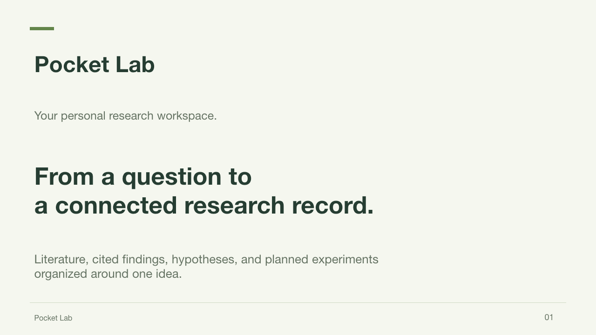
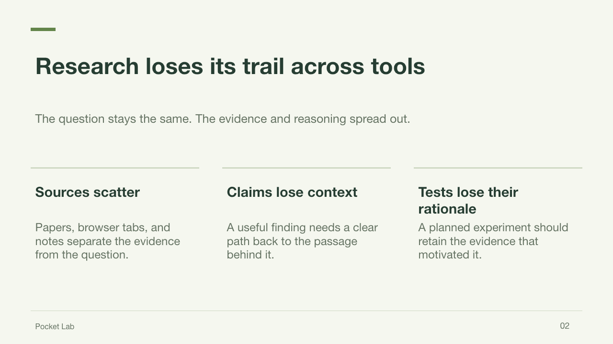
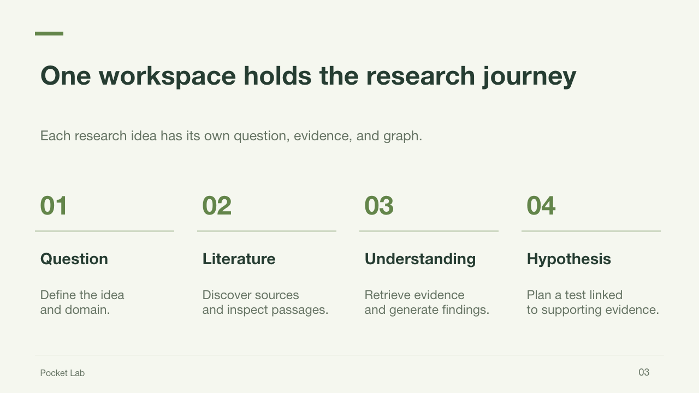
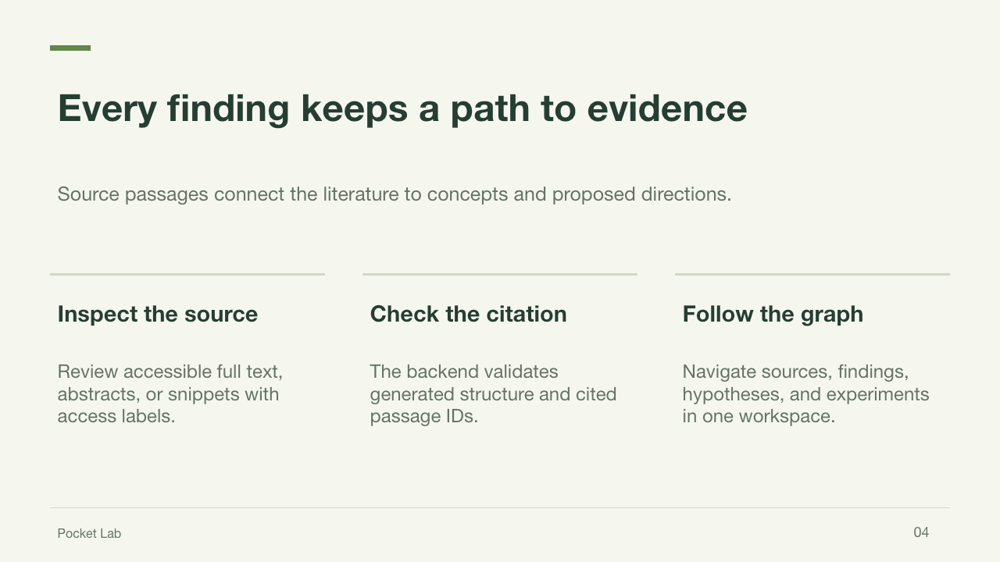
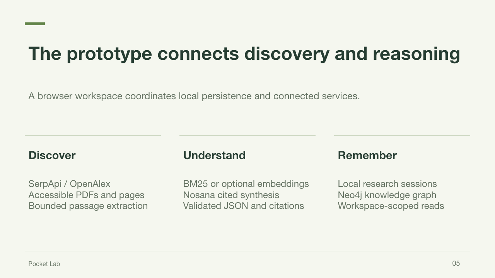
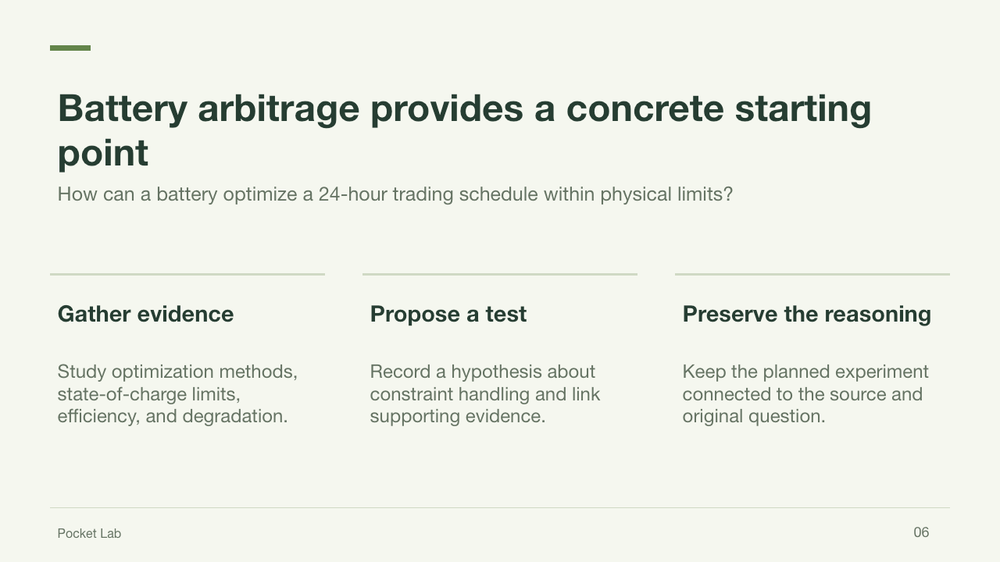
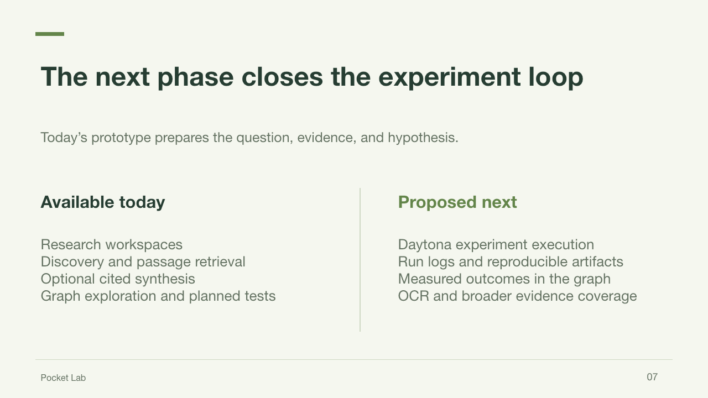
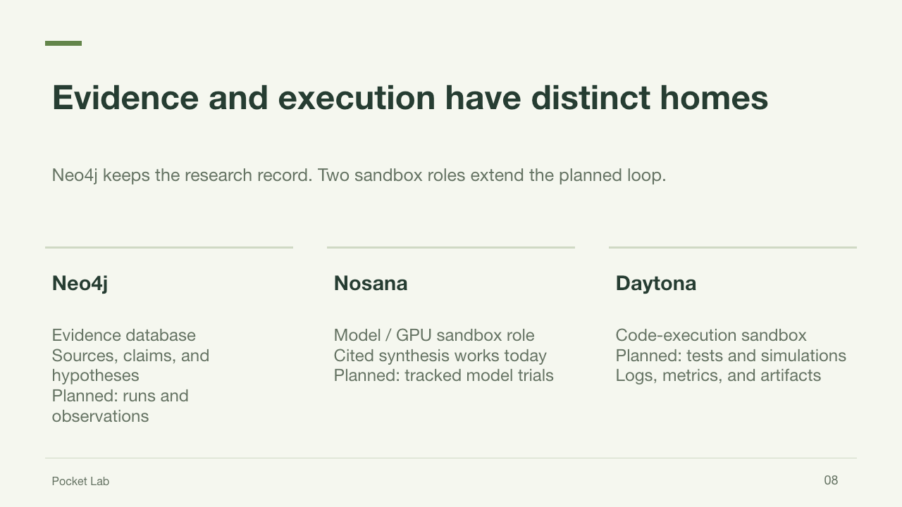
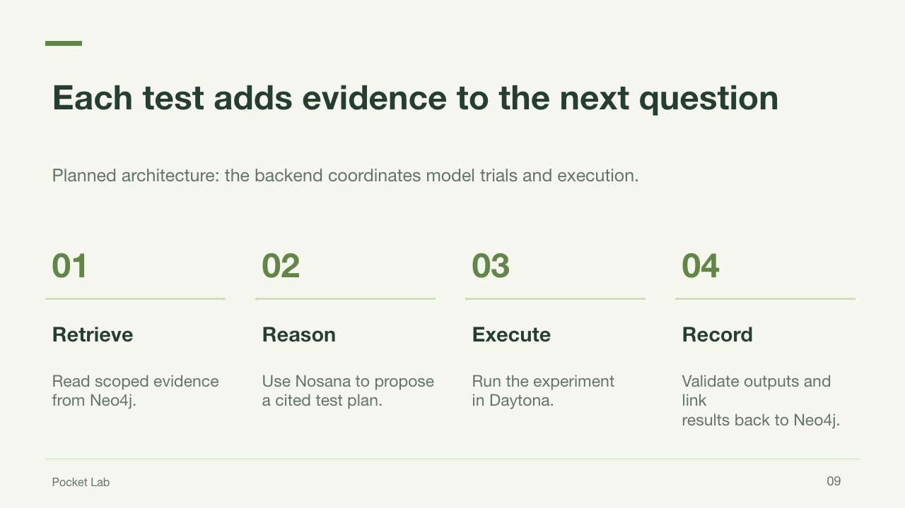

# Pocket Lab

A workspace for each research idea: question → source library → hypotheses and experiments → one shared Neo4j knowledge graph. Includes scholarly discovery, document ingestion, retrieval, and Nosana synthesis. The Battery arbitrage workspace is precreated from the existing battery graph.

## Project presentation

[Download the editable slides](docs/slides/pocket-lab.pptx) · [Project concept](CONCEPT.md) · [Architecture](archi.md)

The nine slides below introduce the project and its current prototype. Planned capabilities are labeled explicitly.



















## Evidence database and research sandboxes

The planned research loop gives each service a distinct role:

| Service | How Pocket Lab will use it | Current status |
| --- | --- | --- |
| **Neo4j: evidence database** | Keep papers, source passages, claims, hypotheses, and experiments connected by provenance. Extend the graph with execution runs, measured results, and artifact references so every conclusion can be traced to literature or a recorded test. | Evidence, hypotheses, experiments, and actual sandbox run records are persisted with provenance. |
| **Nosana: model / GPU sandbox** | Use configurable model deployments to synthesize evidence and propose hypotheses. Record the model, prompt configuration, input evidence IDs, and output for each future model trial so different reasoning approaches can be compared. | Configurable chat inference exists. Per-trial deployment orchestration and model-run provenance are planned. |
| **Daytona: code-execution sandbox** | Create a dedicated environment for an experiment, load its code and selected inputs, run simulations or tests, and collect exit status, logs, metrics, and output artifacts. | Implemented for the built-in battery benchmark: actual Daytona sandbox IDs, command IDs, live logs, validated metrics, and cleanup are recorded. |

Here, “Nosana sandbox” describes the model and GPU experimentation role. Nosana runs container-defined GPU jobs and deployments, while Daytona provides the programmatic code sandbox. The app will coordinate these as separate execution layers. See [Nosana jobs](https://learn.nosana.com/deployments/jobs/) and [Daytona code execution](https://www.daytona.io/docs/process-code-execution).

A future run will retrieve a scoped evidence bundle, ask Nosana for a cited proposal, execute the test in Daytona, and write validated results back through the backend into Neo4j. Generated proposals remain separate from measured outcomes. Local files continue to support unsynchronized work.

## Run

Requires Node.js 22.16+ (tested with Node 25).

```sh
npm install
cp .env.example .env
npm run dev
```

Open http://localhost:5173. Build with `npm run build`, serve the built application and API with `npm start`, and run backend checks with `npm test`. The server binds to localhost; it is a single-user hackathon app, not a public multi-user service.

## Workspace journey

Open **All workspaces** to create a research workspace or continue Battery arbitrage. A new workspace starts with its own question and an empty, isolated graph.

- **Overview:** the research question, real source/experiment/node counts, latest cited findings, and suggested next steps.
- **Literature:** every existing paper/document in the workspace graph, searchable by title; expand the research agent to discover more evidence and review a source collection.
- **Experiments:** design a testable hypothesis, optionally attach a supporting graph node, and save it as a planned experiment. No run metrics are fabricated.
- **Knowledge graph:** all sources, findings, hypotheses, and experiments for that workspace, with node inspection and relationship navigation. Experiments are branches of this graph, not separate graphs.

New records carry a `workspaceId`. Graph reads and supporting-evidence selections are scoped to it. The initial migration associates unscoped existing battery data with Battery arbitrage without removing existing nodes or relationships. Workspace/experiment metadata persists in `data/workspaces/`; evidence sessions remain in `data/`. Neo4j writes are retried on server startup for locally saved workspaces and experiments. The battery runner supports real Daytona execution when DAYTONA_API_KEY is configured.

## Service connections

All credentials are loaded by the server from `.env`. Restart the server after configuration changes.

| Service | Environment variables | Behavior until connected |
| --- | --- | --- |
| Neo4j | `NEO4J_URI`, `NEO4J_USERNAME`, `NEO4J_PASSWORD`, optional `NEO4J_DATABASE` | Local graph saved to `data/`; sync can be retried later |
| Nosana | `LLM_BASE_URL` (including `/v1`), optional `LLM_MODEL` and `LLM_API_KEY` | Indexed evidence and BM25 retrieval work; no generated consolidation |
| Google Scholar via SerpApi | `SERPAPI_API_KEY` | Select OpenAlex as a clearly labeled alternative |
| Optional embedding deployment | `EMBEDDING_MODEL`, optional `EMBEDDING_BASE_URL` | Uses BM25 keyword retrieval; a chat deployment need not serve embeddings |
| OpenAlex | Optional `OPENALEX_API_KEY` | Anonymous searches work subject to provider limits |
| Daytona | `DAYTONA_API_KEY`, optional `DAYTONA_API_URL` and `DAYTONA_TARGET` | Experiment design works; execution stays disabled until authenticated |

Nosana requests use `POST {LLM_BASE_URL}/chat/completions`. The backend checks `/models` and automatically selects a single served chat model when `LLM_MODEL` is blank. Set `LLM_MODEL` explicitly when multiple models are available. Initializing endpoints (HTTP 503) are shown as starting; the research workspace rechecks readiness every 15 seconds. The model must return the requested JSON structure; the server validates the structure and source passage IDs before accepting concepts or directions. No OpenAI account or API key is needed. A separate embedding model is optional; point `EMBEDDING_BASE_URL` to a deployment that supports `/embeddings` if desired.

After connecting Nosana, open the workspace’s Literature section, expand its research notebook, and choose **Generate with Nosana**. Successful consolidation is written back into the workspace graph automatically. No need to repeat paper discovery.

## API endpoints

| Endpoint | Purpose |
| --- | --- |
| `GET /api/health` | Search/LLM configuration status and live Neo4j connectivity |
| `GET /api/workspaces` | List workspaces with graph counts and planned experiments |
| `POST /api/workspaces` | Create a workspace with `{ "name": "…", "idea": "…", "domain": "…" }` |
| `GET /api/workspaces/:id` | Workspace details and statistics |
| `POST /api/workspaces/:id/experiments` | Add a planned experiment with `{ "name": "…", "hypothesis": "…", "sourceNodeId": "optional Neo4j element ID" }` |
| `POST /api/workspaces/:id/sync` | Retry workspace and experiment graph writes |
| `GET /api/graph?workspaceId=:id` | Read the workspace graph (up to 500 nodes and 1,500 relationships; defaults to Battery arbitrage) |
| `POST /api/research` | Start discovery with `{ "idea": "your research idea", "provider": "scholar", "limit": 6, "workspaceId": "battery-arbitrage" }` (`openalex` is also supported) |
| `GET /api/research?workspaceId=:id` | List evidence sessions for a workspace |
| `GET /api/research/:id` | Research status, activity, papers, evidence, synthesis, and graph |
| `POST /api/research/:id/consolidate` | Generate or regenerate cited concepts through Nosana |
| `POST /api/research/:id/sync` | **Neo4j write endpoint**: atomically persist the research graph using configured database credentials |
| `POST /api/research/:id/ask` | Retrieve evidence and optionally generate a grounded answer with `{ "question": "..." }` |

## Showing real sandbox execution

Open **Experiments → an experiment → Run in Daytona**. The execution panel shows actual lifecycle transitions, stdout/stderr snapshots, the sandbox ID, session command IDs, exit codes, wall-clock duration, uploaded Python SHA-256, and validated returned metrics. Closing the panel leaves the remote run active; reopening restores its current state. Stop run requests cancellation and sandbox deletion.

The initial executable recipe is **Battery arbitrage benchmark v1**. Choose a fixed-penalty baseline, adaptive penalty, degradation penalty, or cosine learning-rate variant. Both baseline and variant use the same fixed illustrative 24-hour price profile and physical schedule projection. These metrics describe the benchmark, not a market backtest or automatic proof of an arbitrary hypothesis. Other workspaces need an executable recipe before they can run.

Runtime choices are **Daytona Python** and the supplied **docker.io/nosana/pytorch-jupyter:2.0.0** image, pinned to digest `sha256:6e5c66c0bbe6cd1add87bac0bb4a5b64feee3bf13766dca949d137d32376065c`. The latter is a Nosana-published container running inside a Daytona sandbox; it does not create a Nosana GPU deployment. The first image snapshot may take several minutes. The benchmark explicitly executes on CPU, and remote PyTorch/Python versions and CUDA availability are included in new run results.

Sandboxes are ephemeral, auto-stop after five idle minutes, and have a ten-minute maximum lifetime. The worker deletes them after collection or failure and retains run evidence locally and in Neo4j. Run creation and source preparation are bounded; duplicate concurrent runs in one workspace are rejected. Interrupted runs are marked honestly on restart. No service API keys are forwarded into experiment environments.

Execution API routes use the prefix `/api/workspaces/:workspaceId/experiments/:experimentId/runs`:

- `POST /` starts a run with `{ "variant": "adaptive", "epochs": 1000, "runtime": "daytona-python" }` (runtime may also be `nosana-pytorch`).
- `GET /:runId` returns actual run state, commands, logs, metrics, and provenance.
- `GET /:runId/code` returns the uploaded Python for inspection.
- `POST /:runId/cancel` requests cancellation and cleanup.

Successful and failed attempts are recorded as `(Experiment)-[:EVALUATED_BY]->(ExperimentRun)` and `(Hypothesis)-[:EVALUATED_BY]->(ExperimentRun)` in the same workspace graph.

## Evidence and graph model

The discovery worker deduplicates papers, fetches publicly accessible PDFs/article bodies, and labels abstract or Scholar snippet fallbacks explicitly. It never bypasses paywalls. Downloads are limited to 8 MB with timeouts and public-address checks, including redirects. PDF extraction reads at most 30 pages. Text is split into 1,600-character passages with 200-character overlap, capped at 24 passages per paper; this is a bounded evidence sample, not an exhaustive literature review. Scanned PDFs need a future OCR integration.

Documents with no readable evidence remain listed as metadata only. Empty searches, provider failures, interrupted jobs, inaccessible full text, and malformed or uncited model outputs produce visible errors or explicit partial results. Source-backed does not imply verified scientific truth: generated claims still require review.

The document pipeline persists its extracted evidence into Neo4j: **public document download → PDF/HTML extraction → bounded passages → `Paper` and `Chunk` nodes**. Each `Chunk` stores passage text and its offset and links to its source through `HAS_CHUNK`. Raw PDF/HTML files are not archived in Neo4j. Graph writes occur after retrieval and optional synthesis when Neo4j is configured; failed writes retain local session data for retry. Retrieval currently uses the session passages in memory. See [document ingestion architecture](archi.md#document-ingestion-into-neo4j).

Neo4j stores:

```text
(ResearchTopic)-[:EXPLORES]->(Paper)-[:HAS_CHUNK]->(Chunk)
(ResearchTopic)-[:CONSOLIDATES]->(Concept)-[:GROUNDED_IN]->(Chunk)
(Paper)-[:SUPPORTS]->(Concept)
(ResearchTopic)-[:SUGGESTS]->(ResearchDirection)-[:GROUNDED_IN]->(Chunk)
(Paper)-[:INFORMS]->(ResearchDirection)
(ResearchTopic {kind: "workspace"})-[:HAS_RESEARCH]->(ResearchTopic)
(ResearchTopic {kind: "workspace"})-[:HAS_EXPERIMENT]->(Experiment)-[:TESTS]->(Hypothesis)
(Hypothesis)-[:GROUNDED_IN]->(source node in the same workspace)
```

Writes use parameterized Cypher, a unique ID constraint, and a transaction. Re-syncing replaces that session’s concepts and directions atomically and retains paper/chunk identities. Paper metadata, evidence, vectors (when configured), synthesis, and session state also persist locally under ignored `data/`. The frontend never receives credentials or embedding vectors. Research session graph previews show the graph payload written by sync. The workspace **Knowledge graph** view reads only that workspace’s graph directly from Neo4j, including the imported battery data. It supports searching, filtering, zooming, panning, and inspecting relationships. Viewing the graph never changes database contents.

## Provider documentation

- [SerpApi Google Scholar](https://serpapi.com/google-scholar-api)
- [OpenAlex API](https://help.openalex.org/api/)
- [Nosana LLM inference](https://learn.nosana.com/llm/)
- [Neo4j JavaScript driver](https://neo4j.com/docs/javascript-manual/current/query-simple/)
