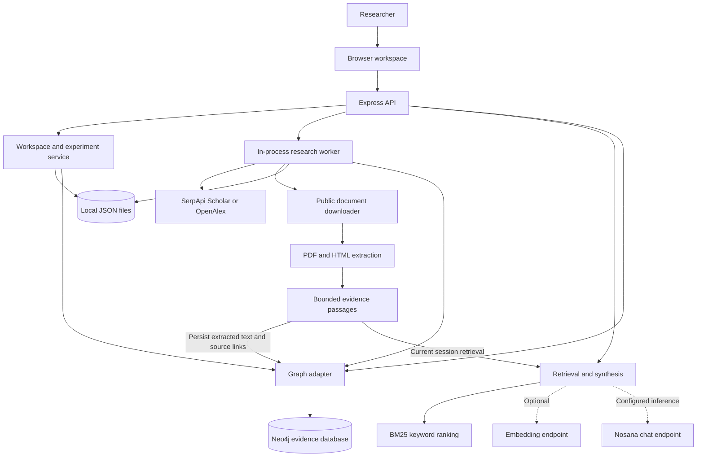
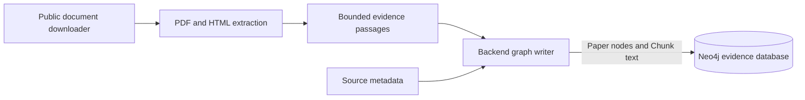
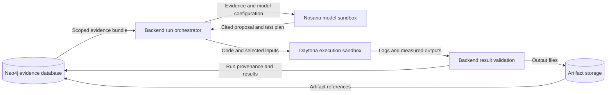
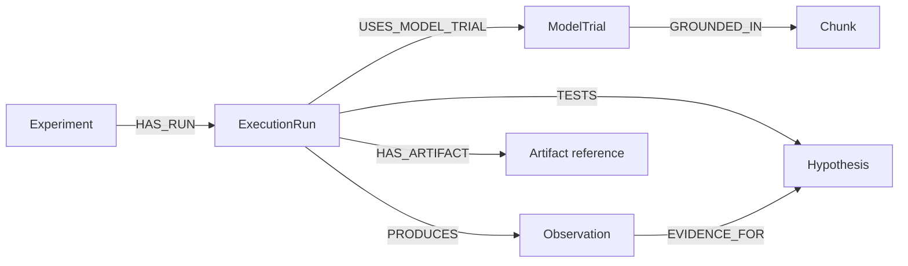
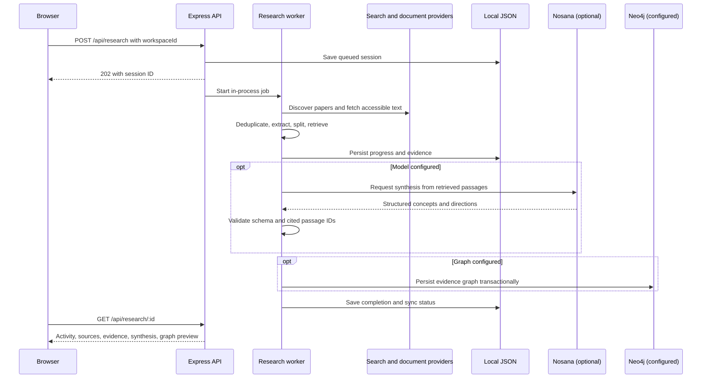
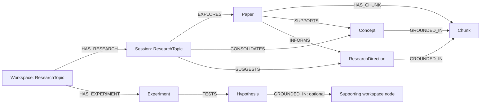

# Pocket Lab Architecture

Pocket Lab is a local, single-user research application. A browser interface calls an Express API, which coordinates scholarly discovery, document ingestion, retrieval, optional Nosana synthesis, local persistence, and Neo4j synchronization. Each workspace scopes its evidence and experiments within a shared graph database.

## System overview

Daytona execution is a proposed extension. The current system saves experiments with `planned` status and does not run them.

## Document ingestion into Neo4j

The public document downloader, PDF/HTML extraction, and passage splitter form the ingestion pipeline for the Neo4j evidence database. Their output is persisted source evidence, not only temporary context for Nosana.

- **Download:** fetch publicly accessible source content, retaining its source URL and access classification.
- **Extract and split:** parse readable text and produce bounded passages with stable IDs and character offsets.
- **Persist:** `persistGraph(job)` stores source metadata as `Paper` nodes and extracted passage text as `Chunk` nodes, linked by `HAS_CHUNK`. Passage nodes include text, offset, optional embedding/model information, and workspace scope. The paper retains its URL, title, access label, provider, year, and a hash of its indexed text.
- **Ground findings:** generated concepts and research directions connect to these stored passages through `GROUNDED_IN`, preserving the route back to the source document.

The stored evidence chain is `(ResearchTopic)-[:EXPLORES]->(Paper)-[:HAS_CHUNK]->(Chunk)`. Neo4j stores the extracted passage text and source metadata. The downloader does not currently archive raw PDF/HTML files or store an additional complete document body in the database. The extraction limits still apply.

**Current persistence timing:** discovery builds passages in the session, retrieves evidence, optionally synthesizes findings, then writes the evidence graph when Neo4j is configured. A failed or unconfigured sync leaves local session data available for an explicit retry. Retrieval currently ranks session passages in memory; it does not yet query Neo4j for its evidence. The planned database-backed execution loop will read its evidence bundles from Neo4j.

## Planned evidence and sandbox execution loop

Neo4j will act as the persistent evidence database. Nosana will provide the model / GPU sandbox role, and Daytona will provide the code-execution sandbox role. This section describes the target architecture. The current implementation diagram above remains the description of the shipped prototype.

The planned research loop gives each service a distinct role:

| Service | How Pocket Lab will use it | Current status |
| --- | --- | --- |
| **Neo4j: evidence database** | Keep papers, source passages, claims, hypotheses, and experiments connected by provenance. Extend the graph with execution runs, measured results, and artifact references so every conclusion can be traced to literature or a recorded test. | Evidence and planned-experiment graph integration exists. Run and result records are planned. |
| **Nosana: model / GPU sandbox** | Use configurable model deployments to synthesize evidence and propose hypotheses. Record the model, prompt configuration, input evidence IDs, and output for each future model trial so different reasoning approaches can be compared. | Configurable chat inference exists. Per-trial deployment orchestration and model-run provenance are planned. |
| **Daytona: code-execution sandbox** | Create a dedicated environment for an experiment, load its code and selected inputs, run simulations or tests, and collect exit status, logs, metrics, and output artifacts. | Planned. The current app saves experiments without executing them. |

Here, “Nosana sandbox” describes the model and GPU experimentation role. Nosana runs container-defined GPU jobs and deployments, while Daytona provides the programmatic code sandbox. The app will coordinate these as separate execution layers. See [Nosana jobs](https://learn.nosana.com/deployments/jobs/) and [Daytona code execution](https://www.daytona.io/docs/process-code-execution).

A future run will retrieve a scoped evidence bundle, ask Nosana for a cited proposal, execute the test in Daytona, and write validated results back through the backend into Neo4j. Generated proposals remain separate from measured outcomes. Local files continue to support unsynchronized work.

### Proposed orchestration

1. **Snapshot the evidence.** Resolve the workspace, hypothesis, and supporting passage IDs. Record an input hash and a run ID so the test retains its original evidence context.
2. **Record a model trial.** Call the configured Nosana deployment with this evidence. Record model identity, prompt version, parameters, input IDs, and generated output. Per-trial deployment creation is a future adapter, rather than an existing feature.
3. **Prepare an executable test.** Review the proposed test, fix its code version, dependencies, dataset references, random seeds, and resource limits, and send only the required inputs to a dedicated Daytona sandbox.
4. **Run and collect.** Track the sandbox ID, run status, timeout or exit code, logs, metrics, and artifact locations. Mark failed or interrupted runs explicitly rather than turning them into findings.
5. **Commit the evidence.** The backend validates the output contract, then persists run metadata, observations, and lineage into Neo4j. Store larger files in artifact storage and link them by URI and content hash. The sandboxes do not receive database credentials or write directly to the graph.
6. **Refine the hypothesis.** Retrieve the new observations alongside the original literature for the next model trial. Any claim about support or contradiction requires review of the measured results.

### Proposed graph additions

These labels and relationships are a design proposal and do not exist in the current graph writer:

Every new record should carry `workspaceId` and stable IDs. A model trial should retain provider, model/deployment identity, prompt and evidence hashes, timestamps, and completion status. An execution run should retain code and environment versions, input hashes, sandbox identity, parameters, seed, start/end times, exit status, and artifact hashes. Observations should contain measured values and units with an explicit link to their run. `EVIDENCE_FOR` records relevance to a hypothesis and does not automatically establish that it is supported.

The orchestration service, sandbox adapters, artifact store, run APIs, and these graph extensions remain to be implemented. The existing JSON session data and Neo4j synchronization continue to describe current persistence behavior.

## Code map

| File | Responsibility |
| --- | --- |
| `src/main.js`, `src/app.js` | Application entry point, workspace navigation, overview, literature, and experiment UI. |
| `src/research-ui.js` | Research discovery, job activity, evidence inspection, and synthesis interface. |
| `src/existing-graph.js` | Interactive view of the workspace graph read from Neo4j. |
| `server/index.js` | HTTP routes, input validation, operation guards, startup, and frontend serving. |
| `server/workspaces.js` | Workspace and experiment metadata, local persistence, migration, and graph sync retries. |
| `server/research.js` | Discovery jobs, source deduplication, document extraction, evidence indexing, and session persistence. |
| `server/retrieval.js` | Passage splitting, BM25 ranking, optional embeddings, synthesis, and citation validation. |
| `server/llm.js` | Model readiness, model selection, and inference headers. |
| `server/graph.js` | Neo4j health, reads, transactional research writes, workspace registration, and experiment links. |
| `server/network.js` | Outbound request handling and public-address checks for document downloads. |

Development uses Vite middleware inside Express. Production serves the Vite build from `dist/`. The API server binds to `127.0.0.1`, using port 5173 by default.

## Research lifecycle

Jobs run inside the API process rather than a durable queue. On startup, saved sessions that were queued or running become failed with an interrupted-job message. The user starts a new search to replace an interrupted job. One active discovery job per workspace is allowed. A separate per-session guard prevents overlapping consolidation and explicit graph-sync operations.

## Evidence and inference

1. Search returns source metadata. The worker tries publicly accessible PDF or HTML content and labels abstract or search-snippet fallbacks.
2. Downloads have an 8 MB limit. PDF extraction reads at most 30 pages. Passage splitting uses 1,600 characters with 200-character overlap and at most 24 passages per paper.
3. BM25 keyword retrieval works without a model. Configured embeddings enable cosine-similarity ranking over stored passage vectors. The discovery worker can fall back to lexical retrieval after a semantic retrieval failure.
4. Nosana synthesis uses `POST {LLM_BASE_URL}/chat/completions`. The backend checks readiness and resolves a served model when possible. Embeddings use a separately configurable endpoint and model.
5. The backend validates the JSON schema and verifies that generated citation IDs belong to the supplied passages. Concepts and proposed directions retain passage links. These checks establish citation lineage, not scientific correctness.

During discovery, unavailable synthesis retains an evidence-only result. Explicit consolidate and ask failures return errors to the UI. Documents without readable evidence remain metadata only. Scanned documents currently have no OCR path.

## Graph model

New graph records carry a `workspaceId`. Workspace graph reads and experiment evidence selections use this scope. Workspace roots use `ResearchTopic` with `kind: "workspace"`. The initial Battery arbitrage migration assigns previously unscoped graph nodes and sessions to that workspace without deleting them.

Research graph writes use parameterized Cypher, a unique ID constraint, and a transaction. Re-syncing a research session replaces its concepts and directions while retaining its paper and passage identities. The interactive workspace graph reads directly from Neo4j, with caps of 500 nodes and 1,500 relationships and an explicit truncation indicator. Research-session previews instead show the graph payload prepared for synchronization.

## Persistence and recovery

| State | Storage | Recovery behavior |
| --- | --- | --- |
| Workspace and planned experiments | `data/workspaces/` JSON plus Neo4j when available | Startup retries graph writes. Explicit workspace sync is also available. |
| Research metadata, passages, optional vectors, synthesis, and activity | Session JSON under `data/` plus synchronized Neo4j records | Local evidence survives missing services. Research graph sync can be retried explicitly. |
| Interactive workspace graph | Neo4j | Unavailable database reads surface a service error. Local session previews remain a separate view. |
| Credentials | Server `.env` | Configuration changes require a server restart. |

Local files and Neo4j are separate persistence systems with visible synchronization status. There is no distributed transaction between them. Local JSON data is ignored by version control.

## API groups

- **Health:** `GET /api/health` reports provider configuration and live model/database status.
- **Workspaces:** list, create, inspect, retry sync, and create planned experiments through `/api/workspaces` routes.
- **Research:** create and list sessions, inspect progress, consolidate, ask evidence questions, and retry graph writes through `/api/research` routes.
- **Graph:** `GET /api/graph?workspaceId=...` reads the selected workspace graph.

See [README.md](README.md#api-endpoints) for endpoint payloads.

## Deployment boundary

The prototype relies on a trusted local user. It has no account system or tenant authorization. Workspace scoping organizes research within that local application. Express limits JSON body size and rejects unapproved cross-origin API requests. Document downloading checks public addresses, including redirects, and applies timeouts and size bounds. Secrets and embedding vectors stay out of frontend responses.

A hosted team version would need identity and authorization, durable background jobs, deployment-specific origin policy, and a deliberate storage and backup strategy. An executor integration would additionally need run configuration, lifecycle tracking, logs, artifacts, and measured results linked to the existing experiment nodes.
